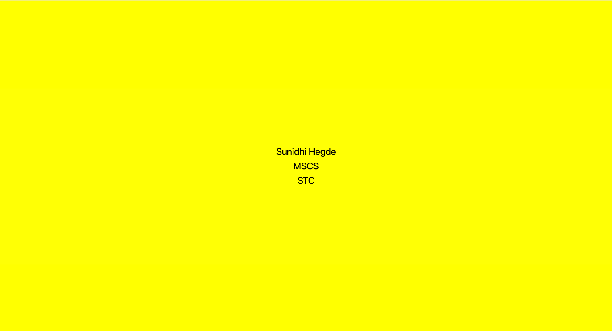

# Input

The application uses three fixed text values as input: the student name, degree program, and school. These values are written directly in App.tsx as Sunidhi Hegde, MSCS, and STC. The user does not enter data while the application is running.

# Process

When Expo starts the project, React Native executes the App component. One View component creates the main container, while three Text components display the required information. StyleSheet.create defines the layout and appearance. The container fills the browser or device screen, applies a yellow background, and centers the content horizontally and vertically. The text style sets the font size, black color, centered alignment, and spacing between lines.

# Output

The program produces a simple Hello World screen. It shows Sunidhi Hegde, MSCS, and STC as three centered lines on a yellow background. The screenshot below confirms that the application runs successfully in the local web browser through Expo at localhost:8081 without any errors.

