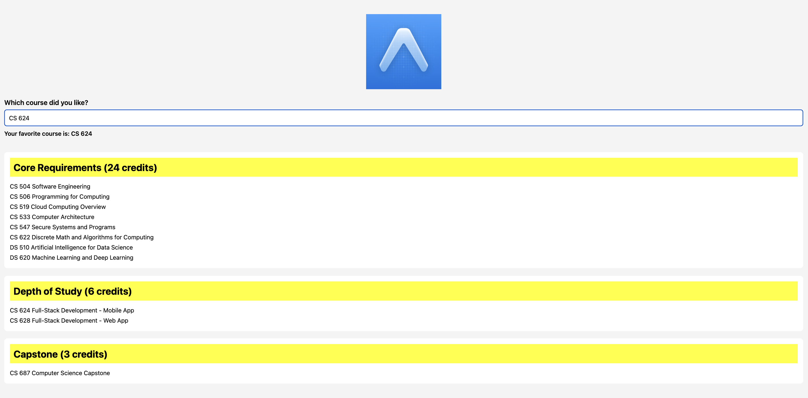

# Input

The application accepts the user’s favorite MSCS course through a TextInput field. The user can enter a course number or name, such as CS 624. The local icon.png file is also used as image input and is loaded from the assets folder.

# Process

The CoreComponents arrow function builds the interface with React Native components. ScrollView makes the page vertically scrollable, View groups related sections, Text displays labels and course information, Image renders the Expo icon, and TextInput captures the user’s entry. The useState Hook stores the favorite course and updates the displayed message immediately. Arrays contain eight core courses, two depth-of-study courses, and one capstone course. StyleSheet applies internal styling, including spacing, borders, font sizes, white cards, and yellow headings.

# Output

The application outputs a styled MSCS course list with the selected favorite course. The screenshot below confirms that CS 624 was entered successfully and that all required sections and components render correctly.

